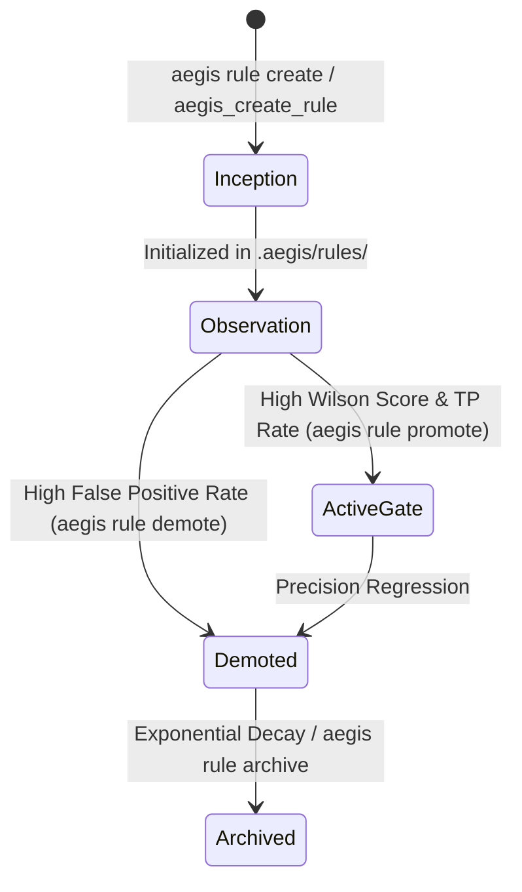

# Rule Lifecycle & Bayesian Fitness Engine

> Adaptive, self-evolving governance rules that promote, decay, and prune based on empirical verification outcomes.

---

## 1. Canonical Rule Types (`.aegis/rules/`)

Aegis workspace rules live in `.aegis/rules/` across four canonical categories. Every rule is a Markdown file with strongly typed YAML frontmatter parsed by the zero-dependency `AegisYAML` parser (`aegis_core/yaml.py`):

| Rule Type | Directory | Default Enforcement | Role |
|:----------|:----------|:--------------------|:-----|
| **`invariant`** | `.aegis/rules/invariants/` | `gate` | Hard architectural, security, and correctness invariants; violations block pre-commit and CI. |
| **`trap`** | `.aegis/rules/traps/` | `advisory` / `gate` | Historical regressions, anti-patterns, and subtle codebase pitfalls discovered during incidents. |
| **`gate`** | `.aegis/rules/gates/` | `gate` | Deterministic verification and release gates enforced during `aegis check`. |
| **`method`** | `.aegis/rules/methods/` | `advisory` | Reusable engineering workflows, agent personas, and domain practices. |

### `AegisYAML` Frontmatter Schema

```yaml
---
id: prevent-unbounded-retry
type: trap
tier: observation
enforcement: advisory
scope:
  paths: ["aegis_core/**/*.py", "aegis_mcp/**/*.py"]
  languages: ["python"]
fitness:
  tp: 8
  fp: 1
  tn: 14
  fn: 0
  score: 0.675
decay: true
created_at: "2026-10-01T00:00:00Z"
---

# Prevent Unbounded Retry Loops

Always bound retry loops with an explicit `max_attempts` parameter and exponential backoff.
```

---

## 2. Evolutionary Lifecycle & CLI Commands

Rules progress through lifecycle tiers (`inception` → `observation` → `active` / `gate` → `decay` → `archived`) driven by real execution outcomes:



### CLI Rule Management (`aegis rule`)

```bash
# List all rules with Thompson Sampling & Wilson Lower Bound fitness scores
aegis rule list

# Create a new typed rule in .aegis/rules/{invariants,traps,gates,methods}/
aegis rule create --type trap --id prevent-unbounded-retry --title "Prevent Unbounded Retry Loops"

# Promote a proven rule up the lifecycle tier (e.g., advisory -> gate)
aegis rule promote prevent-unbounded-retry

# Demote a noisy rule down the lifecycle tier
aegis rule demote prevent-unbounded-retry

# Archive decayed or quarantined rules below the fitness threshold
aegis rule archive

# Clean redundant, orphaned, or leaked rules
aegis rule clean
```

### MCP Rule Authoring (`aegis_create_rule`)

Agents connected to `aegis_mcp` can create rules programmatically using a single-use cryptographic receipt:
1. Call `aegis_request_receipt(operation="aegis_create_rule", args={...})`.
2. Call `aegis_create_rule(rule_id="...", rule_type="trap", content="...", receipt="...")`.

---

## 3. Closed-Loop Evidence Pipeline & Bayesian Scoring

Aegis replaces static rules with a closed-loop evidence pipeline stored in `.aegis/evidence/`:

1. **Signal Emission (`signals.jsonl`)**:
   - **Ambient Telemetry (`record_verification_telemetry`)**: Every `aegis check` / `aegis_verify_changes` execution automatically emits trigger and verification signals to `.aegis/evidence/signals.jsonl` under an atomic cross-process lock (`.aegis/evidence/.signals.lock`).
   - **Explicit Outcome Reporting**: Agents and developers record rule effectiveness via `aegis report` or MCP `aegis_report_outcome` / `aegis_capture_insight`.
2. **Outcome Reflection Engine (`run_outcome_engine`)**:
   - Aggregates raw signals from `signals.jsonl`, attributes proportional credit across modified files, and updates each rule's confusion matrix (`tp`, `fp`, `tn`, `fn`).
3. **Dual Bayesian Fitness Scoring**:
   - **Thompson Sampling (`Beta(tp + 1, fp + 1)`)**: Balances exploration of newly created rules with exploitation of proven high-precision rules during JIT context selection (`aegis_scan`).
   - **Wilson Score Lower Bound**: Computes the 95% confidence interval lower bound on rule precision, penalizing small sample sizes so a rule must accumulate empirical evidence before promotion to a hard `gate`.
