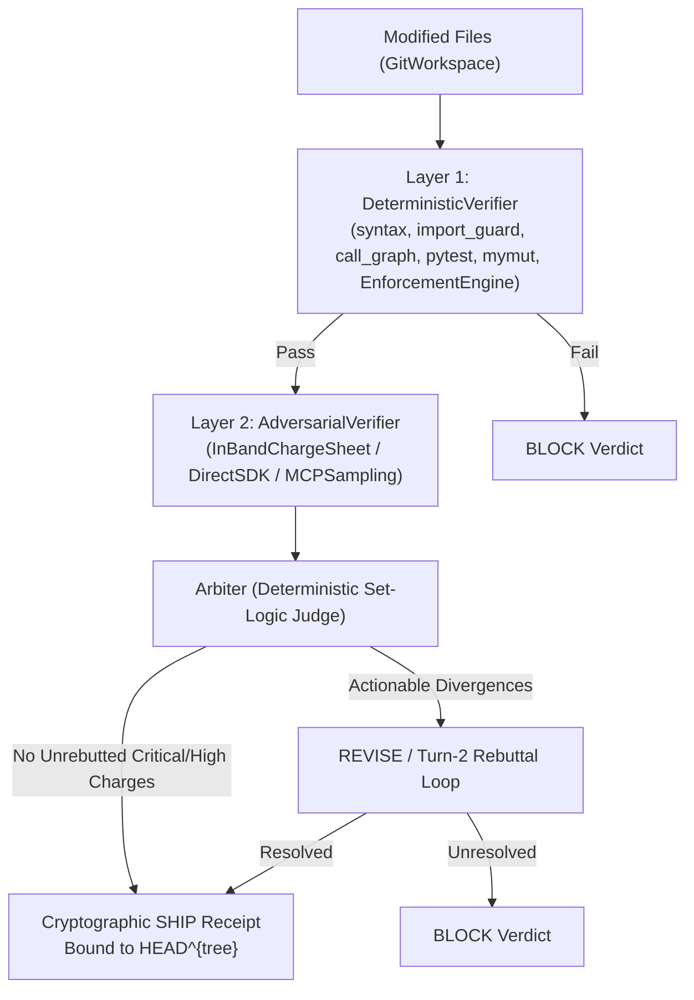

# Verification Pipeline & Release Gate 4.5

> Two-layer closed-loop verification combining `DeterministicVerifier` (Layer 1), `AdversarialVerifier` (Layer 2), and the deterministic `Arbiter`.

---

## 1. Pipeline Architecture (`VerificationPipeline`)

`VerificationPipeline` (`aegis_core/verification/pipeline.py`) orchestrates code verification across two sequential layers before issuing a cryptographically bound verdict (`SHIP`, `REVISE`, or `BLOCK`):



---

## 2. Layer 1: `DeterministicVerifier`

`DeterministicVerifier` (`aegis_core/verification/pipeline.py` & `aegis_core/verification/runner.py`) executes fast, offline static and behavioral checks without LLM calls or network access:

1. **Syntax & Parse Validation (`syntax`)**:
   Verifies AST syntax integrity across modified Python files and configured polyglot AST drivers (`NormalizedAST`).
2. **Import Guards (`import_guard`)**:
   Enforces that optional or undeclared third-party imports are wrapped in `try/except ImportError` or `pytest.importorskip` unless declared in `pyproject.toml`.
3. **Call Graph & Reachability (`call_graph`)**:
   Constructs cross-function call graphs from `DefinitionNode` and `CallSiteNode` trees to detect dead/orphaned functions and broken call targets.
4. **Behavioral Test Execution (`pytest`) & Branch Coverage (`branch_coverage`)**:
   Runs scoped pytest suites and verifies branch execution coverage on modified code paths.
5. **AST Mutation Testing (`mymut` / `mutation_tester`)**:
   Applies operator inversions, boolean flips, and boundary mutations at `MutationPoint` nodes, asserting that behavioral tests kill injected mutants.
6. **Rule & Claim Enforcement (`EnforcementEngine` / `aegis_core/enforcement.py`)**:
   Evaluates active `.aegis/rules/gates/` and `.aegis/rules/invariants/`, bug registry schema integrity (`BUG_REGISTRY.json`), and machine-verifiable claims (`CLAIM_REGISTRY.json`).

---

## 3. Layer 2: `AdversarialVerifier` & `Arbiter`

When Layer 1 passes, `AdversarialVerifier` evaluates semantic alignment, specification compliance, and subtle logic flaws using three pluggable `AgentBackend` strategies:

| Backend Class | Mode | API Key Required? | Description |
|:--------------|:-----|:-----------------:|:------------|
| **`InBandChargeSheetBackend`** | `--in-band` | ❌ Zero-Key | Emits an information-partitioned `ChargeSheet` (`AEGIS-V01`) directly into the active coding session for interactive Turn-2 rebuttal. |
| **`MCPSamplingBackend`** | MCP Sampling | ❌ Zero-Key | Delegates prosecution and defense generation over the client's existing MCP `sampling/createMessage` transport. |
| **`DirectSDKBackend`** | `--full` (headless) | ✅ Env API Key | Invokes configured cloud provider SDKs directly using environment credentials for CI/headless runs. |

### Pure Deterministic `Arbiter` (`aegis_core/verification/arbiter.py`)

Rather than relying on an LLM to make the final pass/fail decision, `Arbiter` is a **pure deterministic set-logic judge**:
- Weighs prosecution `ChargeSheet` items against Layer 1 `ToolEvidence` and Turn-2 defense rebuttals.
- Enforces `AEGIS-V01` information partitioning (raw user prompts and task plans are scrubbed; charges are length-capped and XML-escaped).
- Emits a binding `Verdict` (`SHIP`, `REVISE`, or `BLOCK`) and writes a signed receipt to `.aegis/evidence/arbitration_cycle_{N}.json` bound to `git rev-parse HEAD^{tree}`.

---

## 4. CLI (`aegis check`) & MCP (`aegis_verify_changes`)

### CLI Verification Modes

```bash
# Default: Layer 1 deterministic verification (syntax, import_guard, call_graph, pytest, mymut, EnforcementEngine)
aegis check

# Fast git pre-commit hook mode
aegis check --hook

# Zero-key interactive Layer 1 + Layer 2 charge-sheet verification (InBandChargeSheetBackend)
aegis check --in-band

# Full Layer 1 + Layer 2 adversarial verification with Arbiter verdict
aegis check --full

# Submit a Turn-2 rebuttal to an active Layer 2 charge sheet
aegis check --rebuttal "Charge C1 is guarded by confine_path_internal at confinement.py:22"

# Release Gate 4.5 cryptographic release verification
aegis check --release
```

### Release Gate 4.5 (`aegis check --release`)

Enforced before tagging or merging to `main`, `aegis check --release` cryptographically verifies that:
1. The Git working tree is clean.
2. The latest arbitration cycle in `.aegis/evidence/` concluded with a `SHIP` verdict.
3. The receipt's `tree_hash` matches `git rev-parse HEAD^{tree}` (with HMAC signature verification).
4. Every file modified in `origin/main...HEAD` is covered by the verified receipt.

### MCP Verification (`aegis_verify_changes`)

Agents running under `aegis_mcp` (with `AEGIS_EXECUTION_ENABLED=1`) invoke the pipeline via:
1. `aegis_request_receipt(operation="aegis_verify_changes", args={"files": [...]})`
2. `aegis_verify_changes(files=[...], receipt="<token>")`
3. `aegis_poll_verification(cycle_id="...")` (for asynchronous or multi-turn in-band cycles)
