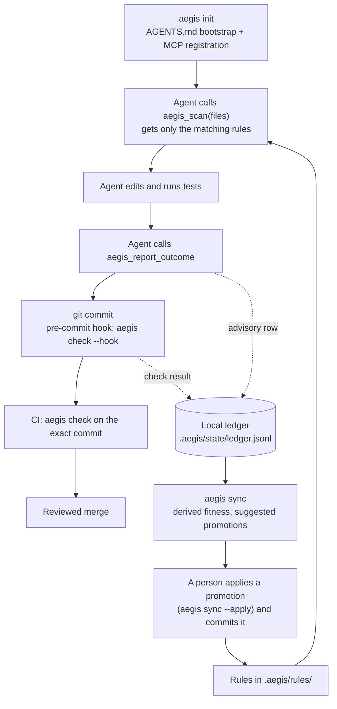

# How Aegis works, end to end

This page follows one change from an agent's first tool call to a merged commit, and explains each part of Aegis on the way: rules, just-in-time delivery over MCP, checks, the evidence ledger, hosts and enforcement. It describes Aegis 4.0. Sections 8 to 10 describe planned work and say so.

For a two-minute setup, start with the [README](../README.md). For every command, flag and MCP tool schema, see the generated [reference](reference.md). For why Aegis is built this way, and what went wrong before v4, see [Why Aegis is built this way](why-aegis.md). The decisions behind this page are in [ADR 0005](adr/0005-v4-plan-of-record.md).

## 1. The loop



1. **Bootstrap.** `aegis init` writes a short marked block into `AGENTS.md` and registers the `aegis` MCP server with the hosts you name. The block holds no rule text; it tells the agent to call `aegis_scan` before editing and `aegis_report_outcome` after verifying.
2. **Scan.** Before editing, the agent calls `aegis_scan` with the files it plans to change. Aegis returns the few rules whose `target_paths` match those files.
3. **Edit and report.** The agent edits, runs its tests and calls `aegis_report_outcome` with the rules it used. The report is an advisory row in the local ledger.
4. **Check.** `git commit` runs `aegis check --hook` (Layer 1 only, never a model call). CI runs `aegis check` on the pull request. CI is the strongest step, but it judges the pull request by the rules in the pull request itself, so changes under `.aegis/` and to the CI workflow need a person's review (section 5).
5. **Learn.** `aegis sync` rebuilds each rule's fitness from the ledger and suggests promotions or demotions. Nothing changes until a person applies a suggestion and commits it.

## 2. What lives where

| Path | Committed? | What it holds |
|---|---|---|
| `.aegis/config.json` | yes | `hosts`, `jit.max_tokens`, rule `expiry`, `ast.packaged_drivers`. It can never name a command: such keys are ignored with a warning. |
| `.aegis/rules/<type>/*.md` | yes | the rules, one file each |
| `.aegis/.gitignore` | yes | ignores `state/` |
| `.aegis/state/` | no | `ledger.jsonl` (outcomes), `activity.jsonl` (scans and edits per session), `derived.json` (written by `aegis sync`), `lock` |
| `AGENTS.md` | yes | one marked bootstrap block; the rest of the file is yours |
| `CLAUDE.md` | yes | an `@AGENTS.md` block, only if the file already existed |
| `~/.aegis/workspaces.json` | user | the repos you ran `aegis init` in on this machine |
| `~/.aegis/rules/` | user | an optional personal rule layer, served read-only where no repo is governed |
| `~/.aegis/config.json` | user | the only place for command-like settings, such as an AST driver command |
| `~/.aegis/backups/` | user | copies of every file `aegis doctor --fix` changed |

Four environment variables are read: `AEGIS_WORKSPACE` (pin the server to one repo; `aegis init --pin` writes it into the registration), `AEGIS_CLIENT` (host identity, written by `aegis init`), `AEGIS_MAX_JIT_TOKENS` (scan budget) and `AEGIS_LLM_CMD` (the Layer 2 model command).

## 3. Rules

A rule is a markdown file with YAML frontmatter. Its directory names its type:

| Type | Directory | Meaning | Served before advisory rules? |
|---|---|---|---|
| `trap` | `traps/` | a known failure mode to watch for | no |
| `invariant` | `invariants/` | must always hold | yes |
| `gate` | `gates/` | a check that blocks a change until it passes | yes |
| `boundary` | `boundaries/` | a sensitive area that needs elevated review | no |
| `persona` | `personas/` | an idiomatic pattern to follow | no |
| `contract` | `contracts/` | an API or data-shape agreement across services | no |

Any rule that declares `enforcement: gate` is also served first. Type and enforcement decide how a rule is ranked and labeled when it is served; what `aegis check` blocks on is a rule's `forbid_ast` patterns (section 5). Here is a rule that `aegis check` enforces:

```markdown
---
id: no-eval
type: invariant
domain: security
enforcement: gate
hypothesis: Agents reach for eval() to parse input
target_paths:
  - "**/*.py"
forbid_ast:
  calls: [eval, exec]
---
Never call `eval` or `exec` on data. Parse it with `json.loads` or `ast.literal_eval`.
```

- **Required fields**: `id`, `type` and `domain`, plus `enforcement` (`gate` or `advisory`) for invariants and traps. An invariant or gate whose enforcement is not `gate` is a "paper gate": it claims to block and enforces nothing, so `aegis check` fails until it is fixed. `hypothesis`, `prediction` and `falsification` say what the rule expects to prevent and what would prove it wrong.
- **`target_paths`** are globs on repository-relative paths. `*` crosses `/`, `**/` matches zero or more directories, a pattern without `/` also matches the file name alone, matching is case-sensitive everywhere, and there is no substring matching. A rule without `target_paths` applies to no file, except a `forbid_ast` rule, which applies to every file.
- **`forbid_ast`** bans `imports`, `calls` or `decorators`. Aliases count (`sp.run()` after `import subprocess as sp` is `subprocess.run()`), and so do `__import__` and `importlib.import_module` with literal names. Computed names, `getattr` and rebinding by assignment are out of reach, because the check is syntactic. A `forbid_ast` rule skips test files unless its `target_paths` name them.
- **Creating rules**: `aegis rule create --type trap --name ID --hypothesis "..." --target-paths 'src/**/*.py' --body-file rule.md` writes the frontmatter for you (`--hypothesis` is required). The `aegis_create_rule` MCP tool turns a concern into a drafting prompt for the agent and writes nothing. `forbid_ast` is added by hand.
- **Starter rules**: `aegis init --rules minimal|standard|full` seeds 2, 5 or all 12 of the shipped [rules](../rules/) as `persona` rules with `target_paths: []`. They apply to no file until you name the files each one governs; `aegis status` and `aegis sync` list them until you do.
- **A file that cannot be loaded stops everything**: the scan fails and names it, and `aegis check` blocks, so a partial rule set is never presented as the whole one.

## 4. Just-in-time delivery over MCP

**The bootstrap.** The `AGENTS.md` block that `aegis init` writes is 572 bytes in a fresh repo. The MCP server sends the same guidance as its `initialize` instructions, which editing files cannot remove. Rule text is never inlined into an instructions file, so it never pushes a host past its size limit.

**The four tools** (schemas in the [reference](reference.md)):

| Tool | What it does |
|---|---|
| `aegis_scan` | the rules that apply to the files about to change (read-only) |
| `aegis_report_outcome` | an advisory outcome row: `success`, `failure` or `partial` (and `tp`/`fp`/`pass`/`fail`) for the named rules, with an idempotency key so a retry is never counted twice |
| `aegis_create_rule` | a prompt for drafting a rule; writes nothing |
| `aegis_list_rules` | every rule with its type, hypothesis and ledger fitness, plus the rules edited since the last `aegis sync` |

**What a scan returns.** One loader reads every rule; if any file fails to load, the scan fails. Rules are matched to the files, then ranked: gates, invariants and other `enforcement: gate` rules first, but they take at most two of the three slots a scan has by default, so a broad mandatory rule cannot starve every advisory one. Mandatory rules that do not get a slot are named in `omitted_mandatory`. Advisory rules are ranked by ledger fitness. The whole response is clamped to the token budget, 2,000 estimated tokens by default (`AEGIS_MAX_JIT_TOKENS` or `jit.max_tokens`); a rule that does not fit is counted, never silently dropped. `view: "summary"` or `"ids"` returns less. For the rule above, a summary scan of `app.py` returns:

```json
{
  "relevant_rules_count": 1,
  "relevant_rules": [
    {"name": "no-eval", "type": "invariant", "enforcement": "INVARIANT (must not violate)", "fitness": 0.0}
  ],
  "invariant_warnings_count": 1,
  "invariant_warnings": [{"name": "no-eval", "type": "invariant", "tier": "gate"}],
  "rules_staged": 1,
  "omitted_mandatory_count": 0,
  "omitted_mandatory": [],
  "stale_rules_count": 0,
  "stale_rules": []
}
```

Without MCP, `aegis scan FILE...` prints the same rules for a person or a shell-only agent.

**Which repository a call governs.** One `aegis-mcp` process can serve sessions in several repos, so every call is bound to a workspace. The first source that names a governed repo (one with `.aegis/`) wins:

1. an operator pin, `AEGIS_WORKSPACE` in the registration; it is strict, and a pin that does not resolve is an error, not a fallback;
2. what the host itself reports: Codex's per-turn workspace metadata, Claude Code's `CLAUDE_PROJECT_DIR`, or MCP roots;
3. the registry `~/.aegis/workspaces.json`: the files in the call may only choose among repos you registered with `aegis init`;
4. a walk up from the server's working directory that stops at the git top level.

There is no workspace argument a model could set, and `$HOME` or `/` is never a workspace. When sources disagree, the call is held with a machine-readable reason instead of governing the wrong repo. When nothing resolves, the server answers "not governed here", and `aegis_scan` serves only the read-only personal layer in `~/.aegis/rules/`, writing nothing.

**Who is calling.** The host id comes from `AEGIS_CLIENT` in the registration (written by `aegis init`, so the model cannot set it), otherwise from the MCP client name, otherwise `generic`. Ledger rows carry `host` and `session` set by the server; a tool argument with the same name is ignored.

## 5. Verification: `aegis check`

**Which files.** Files you name, or else the working-tree changes (`git diff HEAD` plus staged), or else what the branch adds to its base (`origin/$GITHUB_BASE_REF` in a GitHub pull request, then `main` or `develop`), or else the last commit. Untracked files are never picked up on their own: `git add` a new file or name it (`aegis check app.py`).

**Layer 1** runs without a network or a model:

- **Checkpoint checks** over the repository: a test file for each source file, hard-coded absolute paths, assertions per test, rules the ledger says misfire, rule conventions and paper gates. They warn unless you pass `--strict`; a paper gate and a rule file that cannot be loaded always block.
- **Per changed file**: a call-graph check (code that is defined but never wired in), an import guard (every import is standard library, allowed or guarded) and every `forbid_ast` rule that applies. A file a `forbid_ast` rule cannot parse fails; it is never skipped. Mutation tests run only with `--full`.
- **Languages**: Python is parsed in process. Drivers for Rust, TypeScript/JavaScript (needs `node`) and Go (needs `go`) ship in the wheel, and `aegis init` turns them on for the languages it detects (`ast.packaged_drivers`). A repository can only opt in to those packaged drivers; any other driver command comes from `~/.aegis/config.json`, so a cloned repo cannot make Aegis run a program it chose. The driver protocol is in [ADR 0015](adr/0015-normalized-ast-driver-protocol.md).

**Layer 2** is optional: `aegis check --full --plan "what the change should do" --llm-cmd 'claude -p'`. The plan comes from `--plan`, `--plan-file`, or else the first of `docs/plan.md`, `.aegis/plan.md` and `PLAN.md` in the repository; without one, Layer 2 refuses to run. Any command that reads a prompt on stdin and prints a reply works (`codex exec --skip-git-repo-check`, `gemini -p`, a script). Aegis builds two prompts that never see each other's input: a spec reviewer gets the plan and the function signatures and predicts what could go wrong; a code reviewer gets the implementation, the tests and the Layer 1 results and makes claims about them. An arbiter compares the two by risk category, using Layer 1 as the tiebreaker, without asking a model to judge, and returns `SHIP`, `REVISE` or `BLOCK`. The command runs in an empty temporary directory, never in the repository, so the code under review cannot steer its reviewer through project config; and it comes only from `--llm-cmd` or `AEGIS_LLM_CMD`, never from a file in the repository. **This sends your change to whichever vendor the command calls.**

Use a reviewer from a different vendor than the agent that wrote the change. A model reviewing its own vendor's output tends to share its blind spots, and the Aegis release process itself requires a cross-vendor `--llm-cmd` review ([ADR 0005](adr/0005-v4-plan-of-record.md) AD-10). The arbiter's verdict is not yet calibrated against outcomes; scoring it is v4.3 work (section 10).

**The git hook.** `aegis init` installs a pre-commit hook (`aegis hook install|status|uninstall` manage it) that runs `aegis check --hook`: Layer 1 only, never a model. `git commit --no-verify` skips it, which is why CI matters.

**CI.** On GitHub Actions, check out with `fetch-depth: 0` so the base branch is there, then run `pip install aegis-guardrails && aegis check` (the [README](../README.md) has a complete snippet). CI checks the pull request against the rules in the pull request itself: a pull request that deletes a rule and breaks it passes. Review changes under `.aegis/` and to the CI workflow like code; protecting the reviewed rules from the change they judge is v4.3 work.

## 6. Evidence: the ledger and `aegis sync`

**The ledger** is `.aegis/state/ledger.jsonl`, append-only, one JSON row per event. Two things write to it:

- `aegis check` (and the pre-commit hook) appends one row per matched rule per run: `tp` when the run passed, `fp` when it failed. When several rules apply to the same file, they share that file's credit.
- `aegis_report_outcome` appends advisory rows (`success` counts as `tp`, `failure` as `fp`, `partial` as a trigger with no verdict), with a server-set `host` and `session`.

**Fitness** is computed when it is read: the 90% Wilson lower bound of a rule's true-positive rate, halved every `expiry` days since the rule last fired (set per rule type in `.aegis/config.json`). A rule with no verdicts scores 0.

**`aegis sync`** is the one writer of derived state. Under the workspace lock it reads the rules and the ledger, writes `.aegis/state/derived.json` and prints a suggestion per rule:

- **promote** (trap to invariant, invariant to gate) with at least 20 verdicts, fitness of at least 0.85 and an age of at least 30 days;
- **demote** or **archive** when the bound on the rule's false-positive rate is above 0.5.

`aegis sync --apply`, `aegis rule promote|demote RULE_ID` or `aegis rule archive` (every misfiring rule) moves the rule file; commit it and review it like code. `derived.json` also records a hash of each rule file, which is how `aegis_scan` and `aegis_list_rules` flag rules edited since the last sync. It is not a signature and never excludes a rule.

**Why Aegis never rewrites a rule file on its own.** v3 wrote fitness numbers back into each rule's frontmatter. Its integrity manifest then saw "edited" rules and dropped them, so a scan in the author's own session returned 0 rules, and unlocked rewrites lost about 80 of 120 updates under concurrency. In v4 the ledger is the only record of outcomes and rule files change only when a person changes them (the full account is in [Why Aegis is built this way](why-aegis.md)).

**What the score means today.** The credit is coarse. Every rule matching a change's files gets that whole run's pass or fail, and agent self-reports count as much as check runs. For a gate this is backwards. In the README's quick start, after the pre-commit hook and `aegis check` both blocked the `eval`, `aegis sync` shows `no-eval` with 0 true positives and 2 false positives: the gate did its job and was scored as wrong. So fitness only ranks which rules agents see first, and promotion stays a reviewed human step. The fix, a per-rule credit model, is planned for v4.3 (section 10 and [ADR 0005](adr/0005-v4-plan-of-record.md) §8b).

**Compliance.** `aegis status --compliance` reports each host's scan-before-edit rate from `.aegis/state/activity.jsonl`: per session, how many edited files were scanned first. An edit is a file named in `aegis_report_outcome`, or a file in a commit made during exactly one session. The output states its own limits; a session with no observed edit counts as unknown, never as 0.

## 7. Hosts and enforcement

| Host | Registered by `aegis init --host` | How the server learns the repo | Instructions file (size limit) |
|---|---|---|---|
| `claude-code` | `claude mcp add --scope user aegis -e AEGIS_CLIENT=claude-code -- <aegis-mcp>` | `CLAUDE_PROJECT_DIR`, MCP roots | `AGENTS.md` only when no `CLAUDE.md` exists; otherwise the `@AGENTS.md` block in `CLAUDE.md` |
| `codex-cli` | `codex mcp add aegis --env AEGIS_CLIENT=codex-cli -- <aegis-mcp>` | per-turn workspace metadata | `AGENTS.md` (32 KiB, truncated silently) |
| `antigravity` (app, IDE, `agy`) | an `aegis` entry in `~/.gemini/config/mcp_config.json` | the registry only: it sends no roots | `AGENTS.md` (24,000 bytes per file) |
| `gemini-cli` | v4.1; until then by hand | MCP roots | `GEMINI.md`, unless `context.fileName` lists `AGENTS.md` |
| `claude-desktop` | never: identity only | — | — |

`<aegis-mcp>` is the absolute path of the `aegis-mcp` script `init` finds on `PATH`, or, when there is none, the Python interpreter running `aegis` with `-m aegis_mcp`. Until v4.1 adds `--host gemini-cli`, the command Aegis plans to run for Gemini CLI is `gemini mcp add -s user aegis -e AEGIS_CLIENT=gemini-cli -- <aegis-mcp>`; Aegis has not verified it on a real install. Every host runs `aegis-mcp` unsandboxed with your user's permissions, so the server's own confinement is the only boundary. Repository files never register a server: a committed `.mcp.json` would run whatever command a pull request put there.

**Enforcement tiers**, as `aegis doctor` prints them:

| Tier | Mechanism | Status in 4.0 |
|---|---|---|
| Advisory | AGENTS.md bootstrap, MCP instructions, JIT rules | every host |
| Best-effort | per-host pre-tool hooks | v4.1: Claude Code's can block; Codex's fail open and need user trust |
| Local floor | git pre-commit runs aegis check --hook (--no-verify bypasses it) | every host that commits through git |
| Authoritative | CI runs aegis check on the exact SHA; a human merges | your CI and branch protection |

**`aegis doctor`** reads; it changes nothing, makes no network calls and starts no host CLI except `codex mcp get aegis --json` (Codex keeps its registrations in TOML). For each host it reports one state: `missing_binary`, `unregistered`, `auth_unknown` (it cannot confirm the host loads `aegis`), `policy_gap` (the server loads, but the rules do not fully reach the agent, for example a `CLAUDE.md` shadowing `AGENTS.md` or an instructions file past the host's limit) or `ok`. It also reports the strongest tier known to be in force for that host (`local_floor`, `advisory`, `none` or `unknown`), never a guess. `--json` prints the same as one document. `aegis doctor --fix` removes only what doctor reported, such as stale v3 `soma` entries and legacy instruction blocks, after confirmation, and copies each file to `~/.aegis/backups/` first.

**`aegis uninstall`** removes the hook block, the `AGENTS.md`/`CLAUDE.md` blocks, the registry entry and the host registrations, keeping a host that another registered repo still uses. It never deletes `.aegis/`.

**Upgrading from v3.** `aegis migrate` shows the plan and `aegis migrate --apply` performs it: the v3 ledger becomes `.aegis/state/ledger.jsonl`, the old config files become `.aegis/config.json`, `.soma` rules move to `.aegis/rules/<type>/`, and every changed file is backed up first. Then run `aegis doctor --fix`.

## 8. Planned for v4.1: agent teams, per-host hooks and skills

Not in 4.0. The design is in [ADR 0005](adr/0005-v4-plan-of-record.md) AD-7.

- **Lanes and leases.** Each agent works in its own git worktree and branch (a lane). It claims the lane with a lease: a git ref under `refs/aegis/lanes/<lane>`, written with an atomic compare-and-swap (`git update-ref <ref> <new> <old>`) and visible from every worktree. Leases expire after a time-to-live, so no daemon is needed, and a claim whose paths overlap another live lane's is refused. `.aegis/team.json` declares only roles, such as `implementer` and `reviewer`; agents from any host claim them at runtime.
- **Trailers.** Commits carry `Aegis-Lane:`, `Aegis-Role:` and `Aegis-Host:` trailers, so anyone can check that a reviewer's host differs from the implementer's.
- **Post-lane gate.** A deterministic diff check in CI before a lane merges: the lane changed only its own paths, and it did not delete, skip or weaken tests without saying so.
- **Per-host hooks**: a scan-before-edit hook (blocking on Claude Code, a warning elsewhere) and a destructive-command guard built on each host's own deny rules. Until then, `aegis hook safety-gate --cmd "..."` checks one command line and prints a JSON decision.
- **Skills**: `aegis init --skills` will copy the 15 packaged [skills](../skills/) into `.agents/skills/` and `.claude/skills/`. Today, copy the ones you want by hand.
- **Gemini CLI**: `aegis init --host gemini-cli`.

## 9. Planned for v4.2: adoption tools

Not in 4.0. Each feature ships with a stated metric and a prune condition, and is removed if it does not earn its place.

- **Day-0 baseline card**: languages, drivers, rule counts, the Layer 1 pass rate and the files with the most findings, for an existing repository.
- **Ratchet baseline**: record today's findings in `.aegis/baseline.json`, so `aegis check` fails only on new ones.
- **Rule packs**: export rules to a bundle checked by sha256 digests and import them elsewhere. Packs are not signed.
- **Benchmark**: scan latency, payload size and Layer 1 throughput. It measures speed, not whether rules help.
- **Also**: a cross-lane conflict check before dispatching parallel agents, experimental rows for more hosts, a ledger shared by all worktrees, and host plugin packaging.

## 10. Planned for v4.3: trust and evidence

v4.0 removed claims the v3 code could not back, such as self-written release receipts and a manifest that excluded rules it should have protected. v4.3 plans to make those claims true, not to drop them. Its principle is to label locally, confirm externally and approve humanly. The planned work:

- **Witnessed checks**, what v3's self-written receipts claimed to be: credit a rule only for outcomes that CI confirmed on the landing commit; local runs are labels.
- **Rule integrity**: the rules in force are the reviewed versions on the base branch, with git as the witness; weakening one needs approval the agent cannot produce.
- **Per-rule credit model**: standing from evidence the agent cannot forge, always shown with its sample size.
- **Regression discipline**: every fix ships with a test that fails without it.
- **A calibrated Layer-2 arbiter**: its predictions are scored against outcomes, and it binds in CI only once its record earns it.
- **Security checks**: a banned-API policy and established scanners, with SARIF output for code-scanning tools.
- **Human insights**: corrections you make become reviewed rules, and recurrence of the problem is measured.

Why it waits for its own release is explained in [Why Aegis is built this way](why-aegis.md).

## 11. Cheat sheet

Flags and defaults for every command are in the [reference](reference.md); this table only maps tasks to commands.

| I want to... | Run |
|---|---|
| set up a repo and register my hosts | `aegis init --host claude-code,codex-cli,antigravity` (or `--host auto`) |
| see what `init` would do | `aegis init --dry-run` |
| check that each host is wired | `aegis doctor` (`--json` for scripts, `--fix` to repair) |
| see the rules for files I am about to edit | `aegis scan FILE...` |
| check my change | `aegis check` (`--strict` to fail on warnings too) |
| add a model review | `aegis check --full --plan "..." --llm-cmd 'claude -p'` |
| write a rule | `aegis rule create --type trap --name ID --hypothesis "..." --target-paths 'src/**/*.py' --body-file rule.md` |
| list rules and their fitness | `aegis rule list` or `aegis status` |
| see how often agents scan before editing | `aegis status --compliance` |
| rebuild fitness and get suggestions | `aegis sync` (`--apply` to apply them) |
| promote or demote one rule | `aegis rule promote RULE_ID` / `aegis rule demote RULE_ID` |
| manage the pre-commit hook | `aegis hook install` / `status` / `uninstall` |
| upgrade a v3 workspace | `aegis migrate`, then `aegis migrate --apply` |
| remove Aegis from a repo | `aegis uninstall` (keeps `.aegis/`) |
| use Aegis from Python | `from aegis_sdk import Governance; Governance(project_root=".").scan(["app.py"])` |
