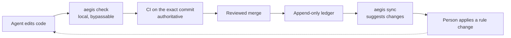

# Why Aegis is built this way: evidence, mistakes, and what changed in v4

This page explains where Aegis's rules came from, what the project measured, what it got wrong, and why v4 looks the way it does. It is written for people deciding whether to trust Aegis, and for contributors deciding what to change next.

**Status.** Written during the v4.0 build (2026-10-15). Where this page describes v4, it describes the decisions in [ADR 0005](adr/0005-v4-plan-of-record.md). The CHANGELOG records what has actually shipped. Section 6 is planned work, not a feature list.

**How to read the numbers.** Every number here is one of two kinds:

- **Re-derived**: computed by a command run at commit `895bbf5`; every such command is listed under [Sources](#sources).
- **Quoted**: taken from a document, with its source and a caveat. Several sources were deleted from the tree in v4; git keeps them. Read one with, for example, `git show 895bbf5:docs/project/METRICS.md`.

## 1. The problem: a rules file is a gentleman's agreement

Coding agents read instruction files (`AGENTS.md`, `CLAUDE.md`, `.cursorrules`) and then act. Nothing checks that they followed the file. In practice they fail in three ways:

- **They skip rules.** Under task pressure an agent follows the letter of a rule and misses its point. The earliest Aegis notes record an agent "verifying" by re-reading the same file four times.
- **They forget.** Long sessions compact context, and new sessions start from zero. The project's session analysis found the same environment traps rediscovered independently across sessions.
- **They fail open.** A check that crashes, a tool that is missing or a rule that is not loaded looks exactly like "no problem found".

Aegis's own history has examples of all three. The v4 review found that `aegis_scan` returned 0 rules in the author's own session, that the AST gate silently skipped files with a byte-order mark, and that the release gate's "SHIP" receipts were written by the agent being gated ([ADR 0005](adr/0005-v4-plan-of-record.md) §1; [review](adr/0005-evidence-review.md) H3, H4, H6).

The author's post on this framing is [Your AI agent's rules file is a gentleman's agreement](https://dev.to/nseney1/your-ai-agents-rules-file-is-a-gentlemans-agreement-heres-what-happens-when-you-build-2dml).

So Aegis tries to do three things, in this order of trust:

1. Check deterministically whatever can be checked, in CI on the exact commit.
2. Put the relevant rule in front of the agent at the moment it edits a matching file, instead of hoping it remembers a long instruction file.
3. Keep a local record of outcomes, so a rule that never helps can be found and removed.

## 2. Where the rules came from

The core rules were not written from best-practice lists. They were extracted from failures.

**The 1,339-step post-mortem.** One real coding session was analyzed step by step. 749 of its 1,339 steps were rework (55.9%, re-derived from the quoted counts). The largest itemized failures, and the rule each one produced:

| Failure | Steps wasted | Rule it produced | Where it lives today |
|---|---|---|---|
| Agent invented game hotkeys instead of checking | 180 | verify UI controls from screenshots, never guess | [providence](../rules/providence.md) §10 |
| Host Python confused with the project venv | 110 | bind `$(VENV)/bin/python` explicitly | [polyglot-standards](../rules/.oracles/polyglot-standards.md) |
| Test polled forever with no timeout | 103 | mock hardware boundaries; time-box polling | [testing](../rules/.oracles/testing.md) |
| A method silently shadowed another | 50 | grep for `def <name>` before defining in large files | [providence](../rules/providence.md) §3 |
| Stale references after a rename | 30 | global grep confirms zero old references | [providence](../rules/providence.md) §3 |

The itemized rows sum to 473 steps (63% of the waste). The other 276 steps happened before step-level tracking existed and were never itemized; 473 + 276 = 749, which matches the quoted total (both re-derived).

*Source*: the evolution log, `docs/architecture/phylogeny.md` "Phase 2", and `docs/project/METRICS.md` "Aggregate Stats" (both at `895bbf5`). *Caveat*: one session, one developer, classified by the project's own analysis with no second rater.

**Cross-session patterns.** Comparing sessions across projects showed the failures were systemic. The worst session ran 1,579 steps with 8 architectural pivots, 2 safety incidents and zero subagent delegation, and produced zero working autonomous runs. It added rules on premature abstraction, pivot discipline (the Two-Pivot Halt), delegation floors and real-time loop budgets, which now live in [architectural-tenets](../rules/.oracles/architectural-tenets.md) and [subagent-delegation](../rules/subagent-delegation.md). It also added a desktop-automation safety rule, which v4 no longer ships ([build sheet](specs/v4-build-sheet.md) D16). *Source*: the evolution log, "Phase 3". *Caveat*: the author's own projects only.

## 3. Design principles

Principles C1–C6 emerged from that work and are listed in the evolution log ("Design Principles"). C7 was learned the hard way and written down in ADR 0005. The v4 build sheet cites them by these keys.

| Key | Principle | In one sentence |
|---|---|---|
| C1 | Evidence over intuition | Every rule traces back to an observed failure; no rule exists "just in case". |
| C2 | Accuracy over speed | An agent never trades correctness for tokens or time. |
| C3 | Rules as a system | Rules reference each other on purpose: providence requires read-before-write, and the refactoring-pilot skill turns that into a phased workflow. |
| C4 | Continuous validation | A rule is never "done"; it is re-checked against new sessions. |
| C5 | Installation completeness | Governance installed at partial fidelity gives false assurance, so every install path deploys rules, skills and hooks with the same completeness. |
| C6 | Hypothesis-driven governance | Every rule and feature states what it predicts, how to measure it, and when to prune it. |
| C7 | Ledger, not frontmatter, for fitness | Outcomes go to an append-only ledger; rule files are never rewritten by the tool that scores them ([ADR 0005](adr/0005-v4-plan-of-record.md) H6, AD-1). |

Three ideas survive from the project's earlier mechanism-design notes (`docs/architecture/mechanism_design.md` at `895bbf5`):

- **External ground truth**: credit should come from signals the agent cannot manufacture, such as CI exit codes and reverts.
- **Graduated enforcement**: a rule earns blocking power (trap, then invariant, then gate) only after evidence.
- **Budget balance**: governance must cost less context than the rework it prevents.

In v3 the first one was claimed but not delivered: an MCP caller could write true- and false-positive signals for any rule ([review](adr/0005-evidence-review.md) H4), and pass/fail credit went to every rule whose paths matched (section 5.2).

## 4. What we measured, and how to read it

| Measurement | Number | Source (at `895bbf5`) | Kind |
|---|---|---|---|
| Waste in the post-mortem session | 749 / 1,339 steps (55.9%) | evolution log, Phase 2 | one session |
| Waste across 17 governed sessions | 1,317 / 7,015 steps (18.8%) | `METRICS.md` "Aggregate Stats" | observational, one developer |
| Same project, weak rules vs full rules | 27.6% of 547 steps vs 1.1% of 1,325 steps | `METRICS.md` "Live A/B Validation" | two sessions, one project |
| 66 masked production sessions, ~7 weeks | rules deployed without skills (an installer gap), so the review steps the rules named could not run | `METRICS.md` "Expanded Dataset Analysis" | observational, different model family |

Percentages are re-derived from the quoted counts. Everything else in the table is quoted.

**Limitations** (the first four are paraphrased from the project's research abstract, `docs/research/abstract.md` at `895bbf5`):

- Differences between the evaluation baselines prevent causal claims.
- Waste classification lacked multi-rater reliability.
- The full rule lifecycle was never validated end to end against human assessment.
- The fitness function optimized for precision and ignored recall (false negatives).
- The "A/B" compares two sessions doing different work at different times, not a controlled experiment.
- Outcome signals in v3 could be written by the agent being measured (review H4), so any fitness number from that period is self-graded.
- Token figures in the old metrics were estimated with a word-count ratio calibrated for one model family, not measured with a tokenizer. This page quotes none of them.

**What the numbers do not show.** They do not show that Aegis's v3 machinery (fitness scores, automatic promotion, receipts) caused the improvement. The rules that coincided with lower waste were plain prose that the agent read. v4 keeps the prose rules and the deterministic checks, and removes machinery whose effect was never measured.

## 5. What we got wrong, and what v4 does instead

An independent multi-lens review graded the code at `9e4d976` (v3.3 plus the first v4 wave) 4/10 on product value and design soundness: "a real problem, a prototype-grade solution, over-built roughly 5-10x". It scored code health, end-to-end behavior and test health 6/10 each, and found the deterministic Layer-1 checks and the zero-dependency, local-first claims genuinely true. (This is the adaptive review listed under ADR 0005 "Evidence"; its report is not in the repository.) The specific mistakes:

### 5.1 Self-minted SHIP receipts

Release Gate 4.5 required a "SHIP" receipt before a release. For v2.0, v2.1, v3.0 and v3.3 the receipt was written by hand by the agent being gated. One contained placeholder predictions `p1` to `p6`; the v3.3.0 receipt claims 8 convergences and lists 5. A hand-written evidence file with `verdict: ship` and the current tree hash passed the gate (review H6). *Source*: ADR 0005 §1, fact 1.

**v4**: receipts and the release gate are deleted ([ADR 0005](adr/0005-v4-plan-of-record.md) AD-2, §5). A release needs CI green on the exact commit SHA and a reviewed merge. Old receipts are treated as unattested, not rewritten. The pre-tag check is `.github/scripts/ci_green.py <sha>`.

### 5.2 The fitness signal was inverted

v3 credited every rule whose paths matched a change with that run's pass or fail. For a gate this is backwards: a gate that blocked 4 bad commits scored 4 false positives and 1 true positive (ADR 0005 §8b). The review also found that "decay to zero" and the sampling the docs described were not what the code did.

**v4**: promotion is a reviewed change. `aegis sync` rebuilds derived state and only *suggests* promotions; applying one is an explicit step (`aegis sync --apply` or `aegis rule promote`) that shows up in review. Credit needs an external signal such as a CI or test exit code, or a revert (AD-2). Which rule actually helped is an open question, pinned for after v4.2 (ADR 0005 §8b); v4 does not claim to answer it.

### 5.3 Rules disabled themselves

v3 wrote fitness numbers back into each rule file's frontmatter at session close. The integrity manifest was not refreshed afterwards, so the next scan saw an "edited" rule, treated it as tampered, and dropped it, with the message only on stderr. On `main`, 45 of 49 manifest entries were stale; `aegis_scan` in the author's own session returned 0 rules. The same write path lost about 80 of 120 updates under concurrency, because the read-modify-write was not locked. *Source*: ADR 0005 §1, facts 3 and 4; the review's end-to-end lane.

**v4**: the append-only ledger is the only source of truth for outcomes; fitness and rollups are derived views, rebuilt by one writer under one lock (AD-1). MCP handlers, hooks and session close never rewrite rule files; `tests/integration/test_no_rule_writes.py` pins that. The HMAC manifest and its keys are deleted; rules are protected by git review and CI, not by Aegis.

### 5.4 Most of the surface was never used

Across about 690 sessions the author's logs show 73 MCP calls, to only 5 of the 17 tools; 12 tools were never called. No rule was ever promoted, demoted or archived in either governed repository (ADR 0005 §5, from the refactor sweep's count of the author's local session logs).

**v4**: the MCP surface is 4 tools (`aegis_scan`, `aegis_report_outcome`, `aegis_create_rule`, `aegis_list_rules`), and the CLI shrinks to the commands in ADR 0005 §5. Receipts, the async job engine (the only daemon thread), the claim and bug registries, the agent-side hook phases and the unreachable code are cut with them. Re-derived at `895bbf5`: the MCP registry lists 4 tools, and the Python in the four `aegis_*` packages went from 39,426 lines in 160 files at `9e4d976` to 22,188 lines in 109 files (43.7% fewer). The docs were cut the same way: this page replaces the evolution log, the metrics log, the research notes and the archive.

### 5.5 Five resets in about 21 hours

On 2026-10-14 the project rebranded, tagged v2.0.0, v2.1.0 and v3.0.0, then started a v4 "Wave 1" 16 minutes after tagging v3.3.0: five foundational resets in about 21 hours. Over its first 19 days it accumulated 850 commits and 94 tags. Wave 1 was committed with the test suite red, as one 4,000-line commit with an empty body. *Source*: ADR 0005 §1 and the review. *Re-derived*: the rebrand (`2c85f58`, 02:50) and Wave 1 (`6f47f13`, 23:30) are 20 h 40 min apart; `9e4d976` has 850 commits since the first one on 2026-09-26, and the repository has 94 tags.

**v4**: on-disk formats carry versions and change through one `aegis migrate` command, so a major version no longer means a clean-slate purge (AD-5). Further paradigm changes to the rule store, host plane or team model need a new ADR (Two-Pivot Halt, ADR 0005 §9). Every wave is reviewed independently before the next starts, and a tag needs CI green on its SHA (AD-10).

### 5.6 Repository files could run commands

A repository's `.aegis/slots.yaml` named AST-driver commands that `aegis check` executed, and its slot values were inlined into the scan output the agent reads (review H5).

**v4**: one `.aegis/config.json`, and repository config cannot name commands or tool slots. Driver commands come only from packaged templates or user-scope config ([ADR 0005](adr/0005-v4-plan-of-record.md) §5 "Config"; [build sheet](specs/v4-build-sheet.md) D10; [ADR 0016](adr/0016-zero-touch-polyglot-genesis.md) status).



## 6. What is next: v4.3 trust and evidence (planned, not shipped)

> **Planned work.** Nothing in this section exists in v4.0, v4.1 or v4.2. It is planned for v4.3, after v4.2 ships. The reviewed spec (2026-10-15) is not in this repository yet; it is expected to land as ADR 0006 before the work starts. Details may change in review.

v4 removes claims it could not back. The plan for v4.3 is to make them true rather than drop them. Its principle is **label locally, confirm externally, approve humanly**: Aegis labels what it observes on the developer's machine, CI on the exact commit confirms outcomes, and approvals the agent cannot produce (a second reviewer, or a signature from a key the agent cannot use) gate governance changes. Every report would say which of these it rests on, at one of three trust tiers: separation of duties, solo with signed approvals, or self-attested.

| Planned component | Replaces | What would become true |
|---|---|---|
| Witnessed checks | v3 receipts | Outcomes credited to rules were confirmed by CI on the landing commit; local runs are labeled and re-checked |
| Git-witnessed rule integrity | the HMAC manifest | The rules in force are the reviewed base-branch versions; weakening one needs approval the agent cannot produce |
| Per-rule credit model | inverted fitness | Standing comes from evidence the agent cannot forge (detector replay over merged history, human-labeled samples), always shown with its sample size |
| Regression discipline in CI | the bug registry | Every fix ships with a test that fails without it, or an approved exemption |
| Calibrated arbiter | the "binding" Layer-2 verdict | Cross-vendor review predictions are scored against outcomes, and bind in CI only once their record earns it |
| Security checks and SARIF | substring "audits" | A banned-API policy and established scanners run on what a change introduces, with findings in PRs |
| Human-insights loop | the unused insight tool | Human corrections become reviewed rules, and recurrence of the corrected problem is measured |

Why this is not in v4.0: the review behind the spec found that nothing on the developer's machine is a reliable witness against an agent running as the same user, that CI is a trust root only when GitHub enforces it, and that per-rule statistics cannot reach a decision at one developer's volume (a holdout would need roughly 500–3,500 eligible sessions per rule, against tens per month). Those findings change the design, so it waits for its own release.

## 7. Predictions you can check

Each v4 decision carries a falsifiable prediction (principle C6). A failed prediction is a result to act on, not something to explain away; where a decision has a prune condition, the table says what gets removed.

| Decision | Prediction | How to check |
|---|---|---|
| AD-1 ledger only | Zero "tampered rule" exclusions and zero lost increments in a 3-process test | The suite's multi-process ledger test (v4.0-b); after real sessions, `git status .aegis/rules` shows no changes made by Aegis |
| AD-2 CI attestation | No release tag without a green CI run on the same SHA | For each tag: `python3 .github/scripts/ci_green.py "$(git rev-list -n1 <tag>)"` exits 0 |
| AD-3 layered core | Duplicate implementations go to 0 and the import-boundary test stays green | Run the import-boundary test (added in v4.0-b) with the suite |
| AD-4 workspace binding | In 3 real sessions per host, every scan resolves to the intended repository and none to `$HOME` | Per session: confirm the scans served the rules of the repository you were in, never `$HOME` |
| AD-5 versioned formats | The next major version ships without a clean-slate purge | Its CHANGELOG entry and `aegis migrate` |
| AD-6 small contract | The contract changes in under 10% of PRs; ghost CLI flags drop to 0 | `git log --oneline -- tests/contract/` against merged PRs |
| AD-7 git-native team | In 20 multi-lane sessions, no cross-lane write conflict reaches a merge | Merge history; prune leases if none is denied in 30 days |
| AD-9 bootstrap and JIT | Scan-before-edit rate of at least 80% on each Phase-1 host after 3 sessions | The per-host compliance rate the server records |

New v4.1 and v4.2 features get a prune box before they merge ([build sheet](specs/v4-build-sheet.md) §3). Examples: lane leases are pruned after 0 denials in 30 days of multi-lane use; the test-integrity gate after 0 human-confirmed catches in 60 days; the benchmark after it catches no regression in 3 releases; an experimental host row after it stays unverified for 2 minor releases.

## 8. Trade-offs

From [ADR 0005](adr/0005-v4-plan-of-record.md) §7, with what each choice costs you.

| Decision | Latency | Complexity | Cost | What you give up |
|---|---|---|---|---|
| Ledger-only fitness (AD-1) | none; `aegis sync` is batch | lower: one writer instead of about 6 | none | fitness shown in rule files is stale until `sync` runs |
| CI attestation (AD-2) | a release waits for CI | lower: receipts deleted | none (free CI) | no offline releases, by design |
| Layered core (AD-3) | none | one-time refactor, then lower | none | merge churn for in-flight branches |
| Workspace resolver (AD-4) | about 1 cached lookup per call | medium | none | `aegis init` once per machine before an Antigravity session can be governed |
| Versioned formats (AD-5) | none | low | none | readers must accept the current and previous format |
| Contract tests (AD-6) | none | lower | none | less "docs match code" coverage, replaced by generated reference docs |
| Git-native team (AD-7) | milliseconds per claim | much lower than a custom swarm package | none | requires git |
| Bootstrap + JIT rules (AD-9) | +1 tool call per edit batch | lower | ADR estimate, not re-measured: 65–190× fewer fixed instruction tokens than inlined rules, 4–11× counting scan payloads | depends on the agent calling the scan tool, hence the measured compliance rate |
| Zero runtime dependencies, no daemons | none | a hand-written YAML subset parser to maintain | none | features that need a library or a background process |

The trade Aegis does not make: it does not claim enforcement it lacks. CI on every PR is the authoritative floor; the local git hook is fast feedback that `--no-verify` skips; per-host agent hooks are best effort and differ by host (AD-8).

## Sources

**Decision records**: [ADR 0005](adr/0005-v4-plan-of-record.md) (plan of record), its [evidence review](adr/0005-evidence-review.md), [ADR 0003](adr/0003-v3-clean-slate-and-cli-ux.md), [ADR 0012](adr/0012-zero-dependency-frontmatter-engine.md)–[0016](adr/0016-zero-touch-polyglot-genesis.md), and the [v4 build sheet](specs/v4-build-sheet.md).

**Deleted documents quoted here**, readable with `git show 895bbf5:<path>`:

- `docs/architecture/phylogeny.md` (the evolution log): post-mortem, cross-session patterns, design principles;
- `docs/project/METRICS.md`: session telemetry, the A/B comparison, the 66-session dataset;
- `docs/research/abstract.md`: the limitations sentences;
- `docs/architecture/mechanism_design.md`: the three incentive ideas.

**Re-derived** (run from the repository root at `895bbf5`):

```sh
python3 -c "print(749/1339, 180+110+103+50+30, 749-473, 1317/7015)"   # 0.559, 473, 276, 0.188
git log -1 --format='%h %ci' 2c85f58; git log -1 --format='%h %ci' 6f47f13   # 02:50 and 23:30 on 2026-10-14
git rev-list --count 9e4d976; git tag | wc -l                                  # 850, 94
git log --reverse --format=%ci 9e4d976 | head -1                               # 2026-09-26 (19 days to 2026-10-14)
git for-each-ref --format='%(creatordate:iso) %(refname:short)' refs/tags/v3.3.0   # 23:14, 16 min before 6f47f13
python3 -c "import aegis_mcp.registry as r; print(len(r.TOOL_DEFINITIONS))"   # 4
# Python lines and files under aegis_core, aegis_cli, aegis_mcp, aegis_sdk (all lines, blank and comment lines included):
for rev in 9e4d976 895bbf5; do
  git ls-tree -r --name-only $rev -- aegis_core aegis_cli aegis_mcp aegis_sdk | grep -c '\.py$'    # 160, 109 files
  git ls-tree -r --name-only $rev -- aegis_core aegis_cli aegis_mcp aegis_sdk | grep '\.py$' \
    | while read -r f; do git show "$rev:$f"; done | wc -l                                          # 39426, 22188 lines
done
```
